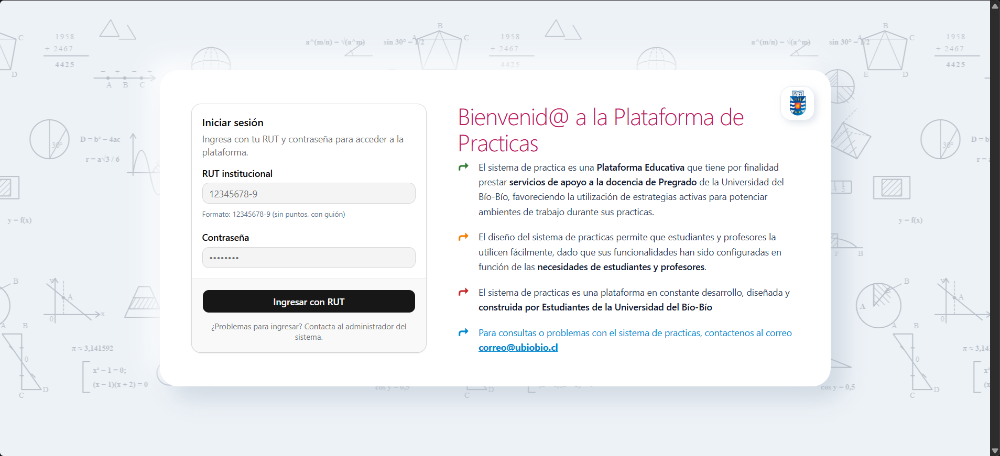

# Sistema de Prácticas UBB

Plataforma web para gestionar el proceso de **práctica pedagógica** de una carrera de pedagogía: seguimiento del estudiante, portafolio de evidencias, evaluaciones, planificaciones de clase y asistencia con inteligencia artificial.




*Pantalla de inicio de sesión: el ingreso es con RUT institucional y contraseña.*

---

## Contenido

1. [Funcionalidades](#1-funcionalidades)
2. [Roles del sistema](#2-roles-del-sistema)
3. [Tecnologías](#3-tecnologías)
4. [Arquitectura y estructura](#4-arquitectura-y-estructura)
5. [Puesta en marcha (desarrollo)](#5-puesta-en-marcha-desarrollo)
6. [Variables de entorno](#6-variables-de-entorno)
7. [Despliegue en producción](#7-despliegue-en-producción)
8. [Importación masiva de usuarios](#8-importación-masiva-de-usuarios)
9. [Comandos útiles](#9-comandos-útiles)
10. [Guía de contribución](#10-guía-de-contribución)
11. [Solución de problemas](#11-solución-de-problemas)

---

## 1. Funcionalidades

| Área | Descripción |
|---|---|
| **Ingreso con RUT** | Inicio de sesión con RUT institucional. Cada usuario ve solo los módulos que su rol permite. |
| **Portafolio** | El estudiante sube evidencias por actividad y el profesor las revisa y califica. Los archivos que sube el profesor no aparecen en el portafolio del estudiante. |
| **Evaluaciones y observaciones** | Notas por actividad, observaciones de evaluación y pautas o rúbricas de la práctica. |
| **Documentos de práctica** | Documentos de la práctica disponibles según el rol, con descarga y seguimiento de tareas y revisiones. |
| **Planificaciones** | Para estudiantes de 8.° semestre en adelante. Cada planificación reúne cinco archivos: planificación, presentación, guía de actividades, rúbrica de evaluación y material didáctico. Se puede guardar con archivos pendientes. |
| **Línea de tiempo de la práctica** | Etapas de inscripción, inicio, seguimiento y evaluación final, calculadas con datos reales: centro, tutor, colaborador y las 6 evaluaciones de la práctica. |
| **Asistente de IA** | Chat con Groq y retroalimentación sobre los archivos de la planificación del estudiante. El profesor puede revisar esa retroalimentación. |
| **Malla curricular y avance** | Una asignatura cuenta como aprobada solo si el estudiante obtuvo la nota correspondiente. |
| **Asociación de práctica** | El coordinador asocia estudiantes con centros de práctica, tutores y profesores colaboradores. |
| **Panel de administración** | Gestión de usuarios, roles y permisos, asignaturas, centros de práctica y documentos, con importación masiva de usuarios desde Excel. |

---

## 2. Roles del sistema

El acceso a cada módulo se controla con **permisos** por rol, configurables desde el panel de administración (`PORTAFOLIO_*`, `EVALUACIONES_*`, `OBSERVACIONES_*`, `ESTUDIANTES_CONSULTAR`, `IA_ACCESO`).

| Rol | Qué puede hacer |
|---|---|
| `ESTUDIANTE` | Portafolio, documentos de práctica, evaluaciones, observaciones, asistente de IA y malla curricular. Desde 8.° semestre ve la vista de práctica: inicio con línea de tiempo, planificaciones, retroalimentación, equipo de práctica y asistente de IA. |
| `PROFESOR_ASIGNATURA` | Crea actividades, revisa y califica evidencias, evalúa, revisa la retroalimentación de IA, consulta portafolios, planificaciones y cursos de práctica, y accede a los documentos de práctica. |
| `PROFESOR_COLABORADOR` | Profesor del centro de práctica. Usa pautas y rúbricas, registra observaciones y sube archivos al portafolio de sus estudiantes. |
| `TUTOR_PRACTICA` | Mismo módulo que el colaborador: pautas y rúbricas, bitácora de observaciones y portafolio. |
| `COORDINADOR` | Asocia estudiantes con centros, tutores y colaboradores; gestiona centros de práctica; consulta evaluaciones, documentos y portafolios. |
| `ADMINISTRADOR` | Panel `/admin` con autenticación Basic configurada por variables de entorno, más gestión de usuarios y permisos. |

---

## 3. Tecnologías

| Capa | Tecnologías |
|---|---|
| **Backend** | Java 21, Spring Boot 4.1, Spring Web, Spring Security, Spring Data JPA / Hibernate, Apache POI (Excel), Maven |
| **Frontend** | React, TypeScript, Vite, Tailwind CSS v4, shadcn/ui, Lucide Icons |
| **Base de datos** | MySQL 8.4 |
| **IA** | API de Groq, invocada solo desde el backend |
| **Infraestructura** | Docker / Podman Compose, Nginx |

---

## 4. Arquitectura y estructura

El frontend es una SPA de React. En producción, Nginx la sirve y reenvía `/api/`, `/admin/` y `/uploads/` al backend; la base de datos no se expone al exterior.

```text
Navegador ──▶ Nginx ──┬──▶ SPA React (archivos estáticos)
                      └──▶ Backend Spring Boot ──▶ MySQL
```

```text
proyectoU/
├── backend/
│   ├── src/main/java/com/backend/
│   │   ├── config/        Seguridad, CORS, migraciones y seeder
│   │   ├── controller/    Endpoints REST
│   │   ├── service/       Lógica de negocio
│   │   ├── repository/    Acceso a datos (Spring Data JPA)
│   │   ├── model/         Entidades JPA
│   │   └── dto/           Objetos de transferencia
│   ├── src/main/resources/application.properties
│   └── Dockerfile
├── frontend/
│   ├── src/
│   │   ├── components/    Vistas por rol (home/*), admin, login y ui
│   │   ├── services/      Llamadas a la API
│   │   ├── hooks/ · lib/ · types/
│   │   └── App.tsx
│   ├── nginx.conf
│   └── Dockerfile
├── docker-compose.yml         MySQL para desarrollo
├── docker-compose.prod.yml    Stack de producción (MySQL + backend + Nginx)
├── .env.example               Plantilla de variables de entorno
└── tablas.md                  Resumen del modelo de datos
```

---

## 5. Puesta en marcha (desarrollo)

### Requisitos

- Java 21 (Maven se incluye con `mvnw`)
- Node.js LTS y npm
- Docker Desktop (o Podman) con Compose
- Git

### Pasos

**1. Clonar y configurar el entorno**

```bash
git clone https://github.com/Aris512/sistemaPractica-UBB.git
cd sistemaPractica-UBB
cp .env.example .env
```

Completa en `.env` al menos `ADMIN_BASIC_USERNAME` y `ADMIN_BASIC_PASSWORD`. Consulta la sección [Variables de entorno](#6-variables-de-entorno).

**2. Iniciar la base de datos**

```bash
docker compose up -d
```

**3. Iniciar el backend** (en otra terminal)

```bash
cd backend
./mvnw spring-boot:run        # en Windows: .\mvnw.cmd spring-boot:run
```

**4. Iniciar el frontend** (en otra terminal)

```bash
cd frontend
npm install
npm run dev
```

**5. Abrir la aplicación**

| Servicio | URL |
|---|---|
| Frontend | <http://localhost:5173> |
| API (backend) | <http://localhost:8080> |

En el primer arranque, Hibernate crea las tablas y el `DataSeeder` carga los datos base (roles, permisos y asignaturas).

### Base de datos local

`docker-compose.yml` levanta MySQL 8.4 con credenciales de **desarrollo** (host `127.0.0.1`, puerto `3306`, base `proyecto_db`). Los valores exactos están en ese archivo y no deben reutilizarse en producción.

---

## 6. Variables de entorno

Se definen en un archivo `.env` en la raíz. **Nunca se sube al repositorio.** La plantilla es `.env.example`.

| Variable | Obligatoria | Descripción |
|---|---|---|
| `ADMIN_BASIC_USERNAME` | Sí | Usuario del panel `/admin`. Sin esta variable el acceso queda bloqueado. |
| `ADMIN_BASIC_PASSWORD` | Sí | Contraseña del panel `/admin`. |
| `GROQ_API_KEY` | No | Clave de [Groq](https://console.groq.com/keys). Sin ella el sistema funciona y el chat avisa que el servicio no está configurado. |
| `GROQ_MODEL` | No | Modelo de Groq. Por defecto `openai/gpt-oss-120b`. |
| `SEED_ADMIN_RUT`, `SEED_ADMIN_PASSWORD` | Solo producción | Administrador inicial de la aplicación (rama `production`). Ver [Despliegue](#7-despliegue-en-producción). |
| `DB_NAME`, `DB_USER`, `DB_PASSWORD`, `MYSQL_ROOT_PASSWORD` | Solo producción | Credenciales de MySQL. En desarrollo déjalas comentadas. |
| `FRONTEND_PORT` | Solo producción | Puerto en el que Nginx publica la aplicación. Con Podman sin root debe ser 1024 o superior. |

> La clave de Groq debe permanecer solo en el backend. Nunca la pongas en el frontend ni en variables `VITE_`. Los límites de uso del chat se ajustan con las propiedades `chat.*` de `application.properties`.

---

## 7. Despliegue en producción

El despliegue se hace desde la rama **`production`**, que incluye el stack de contenedores y un `DataSeeder` mínimo (roles, permisos, asignaturas y un único administrador, sin datos de ejemplo). Levanta tres servicios (MySQL, backend y Nginx) y solo Nginx publica un puerto.

**1. Obtener el código**

```bash
git clone -b production https://github.com/Aris512/sistemaPractica-UBB.git
cd sistemaPractica-UBB
```

**2. Crear el `.env` del servidor** a partir de `.env.example` y completar:

| Variable | Descripción |
|---|---|
| `ADMIN_BASIC_USERNAME`, `ADMIN_BASIC_PASSWORD` | Acceso al panel `/admin`. |
| `SEED_ADMIN_RUT`, `SEED_ADMIN_PASSWORD` | Administrador de la aplicación, que se crea al primer arranque. Sin estas dos variables no se crea ningún usuario y nadie puede ingresar. El RUT debe ser válido. |
| `SEED_ADMIN_NOMBRE`, `SEED_ADMIN_APELLIDO`, `SEED_ADMIN_CORREO` | Opcionales. |
| `DB_NAME`, `DB_USER`, `DB_PASSWORD`, `MYSQL_ROOT_PASSWORD` | Credenciales propias de MySQL. |
| `FRONTEND_PORT` | Puerto público de Nginx (con Podman sin root, 1024 o superior). |
| `GROQ_API_KEY`, `GROQ_MODEL` | Opcionales; habilitan el asistente de IA. |

**3. Levantar el stack**

```bash
podman compose -f docker-compose.prod.yml up -d --build
```

La aplicación queda en `http://<servidor>:<FRONTEND_PORT>`. El proyecto de Compose se llama `proyectou-prod`, así que no interfiere con el MySQL de desarrollo.

**Actualizar tras nuevos cambios**

```bash
git pull
podman compose -f docker-compose.prod.yml up -d --build
```

**Mantener los contenedores al cerrar la sesión SSH:** corren en segundo plano (`-d`), pero con Podman sin root conviene habilitar *linger* para tu usuario.

```bash
loginctl enable-linger <usuario>
```

---

## 8. Importación masiva de usuarios

Desde el panel de administración se pueden crear usuarios subiendo un archivo Excel (`.xlsx` o `.xls`) con estas columnas:

| Columna | Obligatoria | Notas |
|---|---|---|
| `rut` | Sí | Debe ser un RUT válido (dígito verificador correcto). |
| `contrasena` | Sí | Mínimo 6 caracteres. Se almacena cifrada con BCrypt. |
| `rol` | Sí | `ESTUDIANTE`, `PROFESOR_ASIGNATURA`, `PROFESOR_COLABORADOR`, `TUTOR_PRACTICA`, `COORDINADOR` o `ADMINISTRADOR`. |
| `nombre`, `apellido` | Sí | |
| `correo` | Sí | Debe ser único. |
| `asignatura` | No | Solo para estudiantes y profesores; debe coincidir con el nombre de una asignatura existente. |
| `lugar de practica` | No | Solo para tutores, colaboradores y coordinadores; debe existir como centro. |

Las filas con RUT o correo repetidos, o con datos inválidos, se omiten y el sistema informa el motivo de cada una.

---

## 9. Comandos útiles

```bash
# Base de datos
docker compose up -d          # iniciar
docker compose logs -f        # ver logs
docker compose down           # detener

# Backend
cd backend
./mvnw spring-boot:run        # servidor de desarrollo
./mvnw clean package          # compilar y empaquetar
./mvnw test                   # pruebas

# Frontend
cd frontend
npm run dev                   # servidor de desarrollo
npm run build                 # compilar para producción
npm run lint                  # revisar el código
npx shadcn@latest add button  # añadir un componente de shadcn/ui
```

---

## 10. Guía de contribución

**Flujo de trabajo**

1. Crea una rama desde `main` con un prefijo descriptivo: `feat/...`, `fix/...` o `docs/...`.
2. Haz commits pequeños y con mensajes claros, por ejemplo `fix: borrar una práctica ya no falla`.
3. Sube la rama y abre un *pull request* hacia `main`.
4. Fusiona solo después de la revisión.

**Reglas de desarrollo**

- Revisa los requerimientos antes de implementar funcionalidades de negocio.
- Mantén separadas las responsabilidades de frontend, backend y base de datos.
- No pongas lógica de negocio en los controladores: usa servicios. El acceso a datos va en repositorios.
- Mantén los componentes de React organizados y reutilizables.
- Usa TypeScript correctamente y evita `any`.
- No guardes contraseñas, claves ni credenciales reales en el repositorio.
- Prueba cada funcionalidad antes de darla por terminada.
- No elimines configuraciones existentes sin verificar sus dependencias.

---

## 11. Solución de problemas

<details>
<summary><strong>PowerShell no reconoce <code>git</code>, <code>node</code> o <code>npm</code></strong></summary>

Comprueba las instalaciones:

```bash
git --version
java -version
node -v
npm -v
docker --version
```

Si alguno falla, agrégalo al `PATH` de Windows: `Win + R` → `sysdm.cpl` → *Opciones avanzadas* → *Variables de entorno* → `Path` → *Editar* → *Nuevo*. Rutas habituales:

- Git: `C:\Program Files\Git\cmd`
- Node.js: `C:\Program Files\nodejs\`
- npm: `%AppData%\npm`

Reinicia la terminal para aplicar los cambios.
</details>

<details>
<summary><strong>El login de administrador responde "No se pudo conectar con el servidor"</strong></summary>

Revisa que el backend esté en ejecución, que `.env` tenga `ADMIN_BASIC_USERNAME` y `ADMIN_BASIC_PASSWORD`, y que MySQL esté activo (`docker ps`).
</details>

<details>
<summary><strong>El chat de IA indica que el servicio no está configurado</strong></summary>

Define `GROQ_API_KEY` en `.env` y reinicia el backend.
</details>
